# 🤖 RoboUI — On-Device Sketch-to-Website

Upload a hand-drawn UI sketch; a **local, quantized Gemma 4 (E2B/E4B)** model describes it and a second LangChain step writes a single-file site (**HTML + Tailwind via CDN + vanilla JS**). Streamlit UI, no cloud required.

## Quick start (mock mode, no weights)

```bash
cd roboui
python -m venv .venv && source .venv/bin/activate
pip install -r requirements-dev.txt
cp .env.example .env            # ROBOUI_BACKEND=mock by default
pytest                          # run the test suite
streamlit run app.py            # upload a sketch -> preview in sandboxed iframe
```

Mock mode returns a deterministic page so the upload → pipeline → iframe flow can be verified without downloading multi-GB weights.

## Data flow

```mermaid
flowchart LR
    U[Sketch + notes] --> P[Normalize PNG, max 1024px]
    P --> R1[PII regex: notes + optional OCR]
    R1 --> V[vision_prompt to Gemma 4, image turn]
    V --> R2[PII regex on output]
    R2 --> C[Context fit: truncate to budget]
    C --> G[code_prompt to Gemma 4, text turn]
    G --> X[extract_html: strip code fences]
    X --> F[iframe sandbox + CSP]
```



Steps P through X run inside `network_guard()` (outbound sockets denied). The pipeline is a LangChain `RunnableLambda` chain: `prepare | vision | carry_context | codegen`. The vision stage's text description is the only state carried between steps.

## Local model setup (real inference)

1. `pip install -r requirements-llm.txt` (needs a C/C++ toolchain; use `CMAKE_ARGS="-DGGML_METAL=on"` on macOS or `-DGGML_CUDA=on` for NVIDIA).
2. Download a **Q4_K_M GGUF** of Gemma 4 E2B (or E4B) and its **mmproj** file into `roboui/models/` (git-ignored).
3. In `.env`: `ROBOUI_BACKEND=llama_cpp`, and set `ROBOUI_MODEL_PATH` / `ROBOUI_MMPROJ_PATH`.
4. `streamlit run app.py`.

> The llama.cpp backend is written against `llama-cpp-python`'s `Gemma3ChatHandler`. It was **not run against real weights** (by design: no downloads during build/test). GGUF filenames and Gemma 4 handler support depend on your llama-cpp-python version, so expect to adjust paths and possibly the handler.

## Safety & privacy

- **Network isolation:** inference runs inside `network_guard()`, which makes outbound `connect`/DNS raise `NetworkBlockedError`. This is an in-process guard, not a kernel boundary; for hard isolation also run under `unshare -n`, a `--network none` container, or `sandbox-exec`.
- **Generated code isolation:** previews render in `<iframe sandbox="allow-scripts">` (no same-origin, forms, popups) with a CSP of `connect-src 'none'`; only the Tailwind CDN script may load (vendor Tailwind locally for fully offline previews).
- **PII redaction:** emails, API keys/tokens, AWS/GitHub keys, JWTs, private keys, SSNs, phones and card-like numbers are masked in user notes, OCR text (if `pytesseract` + Tesseract are installed) and model output. Without OCR, text written *inside* the image is not scanned. Regex redaction is best-effort, not a guarantee.
- **Secrets:** only via `.env` (git-ignored); `.env.example` is the template. The `cloud` backend is opt-in and is the only path that uses the network.

## Hardware adaptation

- 4-bit GGUF quantization, `use_mmap`, small batch size.
- `ROBOUI_N_GPU_LAYERS=-1`: full offload if the model fits in free VRAM, else a proportional layer count.
- **Context throttling:** `n_ctx` = min(`ROBOUI_MAX_CTX`, what fits in ~60% of free VRAM/RAM after the model), floored at `ROBOUI_MIN_CTX`. Per-token cost is a conservative heuristic, not a measurement.
- Load/inference failures raise `ModelFileMissingError` / `OutOfMemoryError` with remediation text, shown in the UI and logged.

## Context management across the two stages

`plan_context(n_ctx)` reserves output tokens for the HTML (at most half the window, max 4096) plus prompt overhead, and gives the remainder to the description. The vision stage is told to stay within that word budget; the description is truncated (head kept) if it still overflows, so the code step always fits. Token counts use a ~4 chars/token estimate.

## Local Gemma 4 vs. cloud API

| | Local Gemma 4 (E2B/E4B, Q4) | Cloud API |
|---|---|---|
| Privacy | Sketch never leaves the machine | Image sent to a third party |
| Cost | Free after download | Per-token |
| Quality | Fine for simple layouts; weaker on complex pages | Typically higher |
| Latency | Hardware-dependent | Fast, consistent |
| Setup | GB-scale weights, build toolchain | API key |
| Offline | Yes | No |

## Layout

```
roboui/
  app.py            Streamlit UI
  src/roboui/       config, hardware, pii, prompts, extract, inference, sandbox, pipeline
  tests/            pytest suite
```
